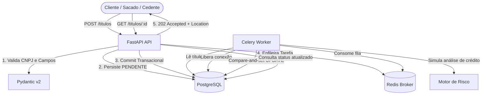

# Motor de Antecipação de Recebíveis (FIDC Mock)

API e worker assíncrono para recebimento, validação cadastral/estrutural e análise de crédito de títulos financeiros (duplicatas mercantis / notas fiscais) para Fundos de Investimentos em Direitos Creditórios (FIDCs).

Desenvolvido com foco em **alta confiabilidade transacional, integridade financeira e resiliência de mensageria**, seguindo princípios de **Spec-Driven Development (SDD)** e **Test-Driven Development (TDD)**.


> **Demo no ar (ambiente de testes):** API em http://184.194.48.52 · Swagger em http://184.194.48.52/docs
> Sem autenticação nem HTTPS, apenas dados fictícios. Veja a seção "Débitos técnicos intencionais" abaixo.

---

## 🏗️ Arquitetura do Sistema



---

## 🚀 Decisões de Engenharia e Boas Práticas Financeiras

1. **Precisão Monetária Absoluta (`Decimal` / `Numeric(18,2)`)**:
   - `float` nunca é utilizado. Cálculos e validações de moeda utilizam precisão arbitrária para impedir erros de arredondamento IEEE 754 inaceitáveis no mercado financeiro.
2. **Commit antes do Enfileiramento (Prevenção de Race Condition)**:
   - O título é persistido e comitado no banco de dados **antes** de enviar a mensagem ao Celery. Isso garante que o worker nunca receba o ID de um registro que ainda não esteja visível para leitura.
3. **Compare-and-Set Idempotente (`UPDATE ... WHERE status = 'PENDENTE'`)**:
   - Para prevenir condições de corrida entre múltiplos workers consumindo mensagens duplicadas (at-least-once delivery), a transição de estado usa SQL condicional atômico. Se o status já tiver mudado, nenhuma linha é alterada e a operação não corrompe os dados.
4. **Desconexão de Banco durante Operações Bloqueantes**:
   - A transação inicial é encerrada antes da execução da análise de crédito (`sleep` / chamada externa). Manter conexões do pool abertas durante processamento lento esgota o pool do PostgreSQL em alta volumetria.
5. **Resiliência do Celery (`acks_late=True` e `retry_backoff`)**:
   - Tarefas só são confirmadas ao broker **após** a execução com sucesso. Em caso de falha transitória de infraestrutura de banco (`OperationalError`), a tarefa sofre retry automático com backoff exponencial (até 3 tentativas).
6. **Observabilidade e Sigilo de Dados Bancários / LGPD**:
   - Logs 100% estruturados em JSON serializados por linha.
   - **O CNPJ nunca é registrado nos logs**, garantindo sigilo bancário e conformidade com a LGPD.
   - O cabeçalho da resposta sempre propaga ou gera `X-Request-ID`; o `request_id` aparece nos logs de erro 500 e no corpo da resposta de erro, permitindo rastrear o stack trace sem expor detalhes ao cliente.
7. **Simplicidade Arquitetural (FastAPI Idiomático em Camadas)**:
   - Estrutura clara: `api` → `services` → `models`/`db`; `worker` → `services`. Sem complexidade acidental de arquitetura hexagonal, repositórios desnecessários ou injeção de dependências pesada.
8. **Banco e Migrações Gerenciados por Alembic**:
   - O schema de banco é versionado via Alembic (`alembic upgrade head`). A aplicação web não cria tabelas por `create_all`, garantindo controle de deploys e rollback seguro (`downgrade`).

---

## 🛠️ Stack Tecnológica

| Componente | Tecnologia | Finalidade |
|---|---|---|
| **Linguagem & Ambiente** | Python 3.14 + uv | Gerenciamento ultrarrápido de dependências e ambiente |
| **Framework Web** | FastAPI | Endpoints assíncronos de alta performance e documentação OpenAPI |
| **Validação de Dados** | Pydantic v2 + pydantic-settings | Validação estrutural rigorosa e tipagem forte |
| **Banco de Dados & ORM** | PostgreSQL 17 + SQLAlchemy 2.x + psycopg 3 | Persistência relacional robusta com pool de conexões com `pre_ping` |
| **Mensageria & Filas** | Celery + Redis 7 | Enfileiramento e execução de análises de crédito em background |
| **Migrações** | Alembic | Versionamento declarativo de banco de dados |
| **Linter & Formatação** | Ruff | Qualidade de código, padronização e linting contínuo |
| **Testes de Qualidade** | Pytest + Pytest-Cov | 100% dos testes unitários, de integração e infraestrutura |
| **Conteinerização** | Docker & Docker Compose | Ambientes reproduzíveis e orquestração de microsserviços |

---

## 📋 Endpoints da API

A documentação é gerada a partir do código (OpenAPI 3) e fica sempre em dia com a API:

| Interface | Caminho |
|---|---|
| Swagger UI (testar as chamadas no navegador) | `/docs` |
| ReDoc (leitura) | `/redoc` |
| Contrato OpenAPI em JSON | `/openapi.json` |

Cada operação traz descrição, exemplos de payload e todas as respostas de erro (`404`, `422`, `500`, `503`) no envelope padrão.

### `POST /titulos`
Submete um novo título para antecipação de recebíveis.

- **Status Code**: `202 Accepted`
- **Header**: `Location: /titulos/<id>`
- **Payload**:
  ```json
  {
    "cnpj_sacado": "11.222.333/0001-81",
    "valor_titulo": "1500.50",
    "data_vencimento": "2026-12-31"
  }
  ```
- **Resposta**:
  ```json
  {
    "id": "76d5e751-64d5-452f-8700-1c356e9196b6",
    "status": "PENDENTE"
  }
  ```

### `GET /titulos/{id}`
Consulta o status e os dados detalhados de um título submetido.

- **Status Code**: `200 OK` (ou `404 Not Found` caso inexistente)
- **Resposta**:
  ```json
  {
    "id": "76d5e751-64d5-452f-8700-1c356e9196b6",
    "cnpj_sacado": "11222333000181",
    "valor_titulo": "1500.50",
    "data_vencimento": "2026-12-31",
    "status": "APROVADO",
    "criado_em": "2026-10-11T20:00:00Z",
    "atualizado_em": "2026-10-11T20:00:05Z"
  }
  ```

### `GET /health`
Verificação de saúde do serviço (usado por orquestradores como Kubernetes / Docker Compose).

- **Status Code**: `200 OK`
- **Resposta**: `{"status": "ok"}`

### Envelope de Erro Unificado
Todas as respostas de erro da API seguem um contrato único e previsível:
```json
{
  "error": {
    "code": "VALIDATION_ERROR",
    "message": "Payload inválido.",
    "details": [
      {
        "field": "cnpj_sacado",
        "message": "CNPJ com dígitos verificadores inválidos."
      }
    ]
  }
}
```

---

## 🧪 Testes e Cobertura

O projeto foi construído sob TDD estrito com isolamento total de dependências externas nos testes diários:

```bash
# Executar a suíte de testes completa (unidade + integração + infra):
uv run pytest

# Executar medição de cobertura de código (atinge 97% de cobertura):
uv run pytest --cov=anticipation_engine --cov-report=term-missing

# Executar checagem estática com Ruff:
uv run ruff check .
uv run ruff format --check .
```

---

## 🐳 Executando com Docker Compose

Para subir o ecossistema completo (API, Worker Celery, PostgreSQL 17 e Redis 7):

1. Configure as variáveis de ambiente:
   ```bash
   cp .env.example .env
   ```
2. Inicialize os containers:
   ```bash
   docker compose up -d --build
   ```
3. Acompanhe os logs dos serviços:
   ```bash
   docker compose logs -f api worker
   ```
4. Execute os testes E2E com a infraestrutura no ar:
   ```bash
   uv run pytest -m e2e
   ```

A API fica em `http://localhost:8000` (documentação interativa em `/docs`) e responde apenas em localhost. O banco e o Redis não são expostos ao host.

Comandos úteis:
```bash
docker compose up -d --scale worker=3   # mais workers consumindo a mesma fila
docker compose down                     # para os containers (mantém os dados)
docker compose down -v                  # para e apaga os volumes (recomeça do zero)
```

---

## 🔬 Testando a API

Há três formas, da mais rápida à mais próxima de produção. Nos exemplos, `BASE` é o endereço da API.

### 1. Suíte automatizada (sem Docker, SQLite + fakes)
```bash
uv run pytest
```

### 2. Local com PostgreSQL, Redis e worker reais (Docker Compose)
```bash
cp .env.example .env
docker compose up -d --build
BASE=http://localhost:8000
```

Teste pelo Swagger (`$BASE/docs`) ou pelo terminal:
```bash
# 1) enviar um título: responde 202 na hora, com status PENDENTE
curl -s -X POST $BASE/titulos -H "Content-Type: application/json" \
  -d '{"cnpj_sacado":"11.222.333/0001-81","valor_titulo":"1500.50","data_vencimento":"2030-12-31"}'

# 2) consultar com o "id" retornado: PENDENTE agora, APROVADO cerca de 5 s depois
curl -s $BASE/titulos/<id>

# 3) regra de crédito: valor acima de R$ 1.000.000,00 (ou prazo acima de 365 dias) é REJEITADO
curl -s -X POST $BASE/titulos -H "Content-Type: application/json" \
  -d '{"cnpj_sacado":"11.222.333/0001-81","valor_titulo":"2000000.00","data_vencimento":"2030-12-31"}'

# 4) validação: CNPJ inválido responde 422 no envelope de erro
curl -s -X POST $BASE/titulos -H "Content-Type: application/json" \
  -d '{"cnpj_sacado":"11.111.111/1111-11","valor_titulo":"10.00","data_vencimento":"2030-12-31"}'
```
(`data_vencimento` precisa ser uma data futura. No PowerShell use `curl.exe` em vez de `curl`.)

**Postman:** importe os arquivos da pasta `postman/` (a coleção e os ambientes *Local* e *AWS*), escolha o ambiente e rode a coleção no Collection Runner. São 14 requisições com asserções (fluxo aprovado, rejeitado e erros) e levam cerca de 30 s por causa da análise assíncrona. Pela linha de comando: `npx newman run postman/anticipation-engine.postman_collection.json -e postman/local.postman_environment.json`.

Conferir o que ficou gravado no PostgreSQL e rodar o E2E automatizado:
```bash
docker compose exec db sh -c 'psql -U "$POSTGRES_USER" -d "$POSTGRES_DB" -c "select id, status, valor_titulo from titulos order by criado_em desc limit 5"'
uv run pytest -m e2e
```

### 3. No link real (demo publicada)
A demo roda o mesmo `docker compose` em uma instância EC2, descrita em `deploy/aws` (CloudFormation), e fica no ar durante o período de avaliação:
```bash
BASE=http://184.194.48.52
curl -s $BASE/health            # {"status":"ok"}
```
- Swagger: http://184.194.48.52/docs; os passos 1 a 4 acima valem sem alteração.
- Postman: no ambiente *AWS* (`postman/aws.postman_environment.json`) confira se `baseUrl` aponta para o endereço da demo e rode a mesma coleção.
- E2E contra o link real: `E2E_BASE_URL=$BASE uv run pytest -m e2e`
- A demo é um ambiente de testes sem autenticação nem HTTPS: use apenas dados fictícios.

---

## ⚠️ Débitos técnicos intencionais

Decisões conscientes para manter o projeto simples e barato (detalhes em `docs/02-plan.md`, seção 6):
- **Sem autenticação nem autorização**: a API e o Swagger são abertos para facilitar a avaliação. Use apenas dados fictícios.
- **Sem HTTPS** na demo publicada (exigiria domínio e certificado).
- **Sem rate limiting**.
- **Instância única, sem backup do banco** (PostgreSQL e Redis em containers na mesma máquina).
- **Sem outbox/reconciliação**: se a fila cair, o título fica `PENDENTE` e a API responde 503.

---

## 💡 Fora do MVP (Evoluções para Produção Real)

Em produção, em escala financeira, as seguintes extensões seriam integradas:
- **Transactional Outbox Pattern**: Garantir envio transacional de mensagens para o broker mesmo em quedas catastróficas simultâneas de banco e rede.
- **Job de Reconciliação Periódica (Celery Beat)**: Reprocessar títulos que permaneceram em `PENDENTE` devido a indisponibilidades temporárias no enfileiramento (respostas 503).
- **Autenticação e Autorização**: mTLS entre sistemas internos, e OAuth2/JWT com escopos granulares de cedente/fundo.
- **Idempotency-Key**: Suporte ao header `Idempotency-Key` no endpoint de criação para prevenir cobranças ou submissões duplicadas causadas por retries de clientes.
- **Métricas Prometheus & OpenTelemetry**: Rastreamento distribuído de latência das análises e taxas de aprovação/rejeição por lote de carteira de recebíveis.
